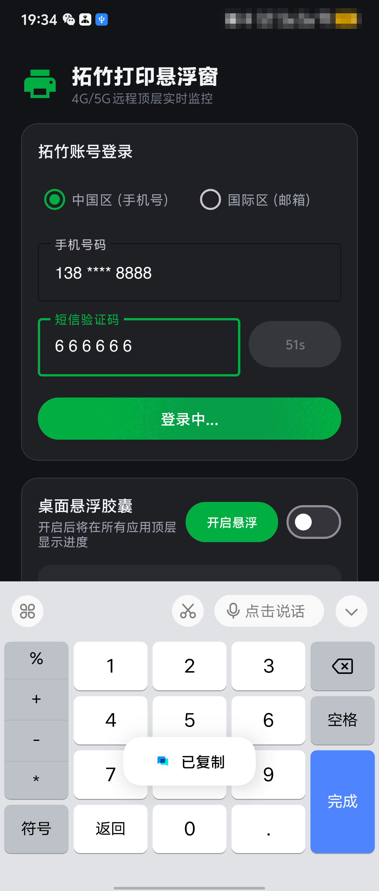
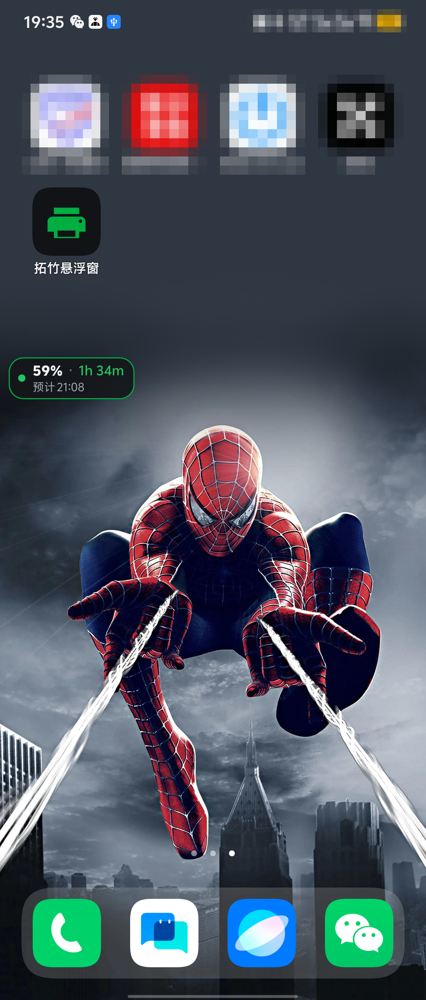
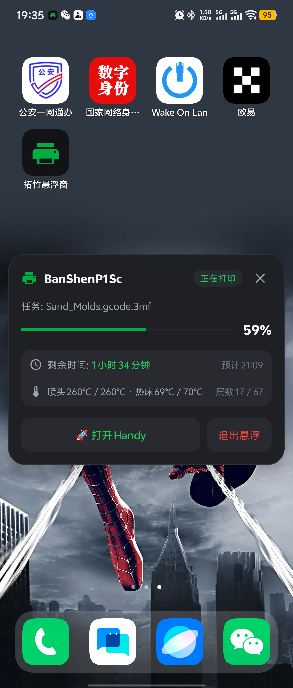

# 🖨️ Bambu Float Widget (拓竹打印悬浮窗)

<p align="center">
  
</p>

<p align="center">
  <b>一款优雅、轻量级的拓竹 (Bambu Lab) 3D 打印机 Android 桌面全局悬浮窗工具</b><br>
  随时随地在手机顶层掌握打印进度、剩余时间、喷头热床温度与层数，支持 4G/5G 移动网络远程监控。
</p>

<p align="center">
  <a href="https://github.com/hanwei87/bambuhandy-float/releases/latest"></a>
  <a href="#-功能特性"></a>
  <a href="#-技术架构"></a>
  <a href="#-快速开始"></a>
  <a href="#-开源协议"></a>
</p>

---

## 📥 软件下载 (Download)

无需自行搭建 Android 开发环境，直接下载安装包即可上手使用：

- 🚀 **最新版本下载**：[👉 点击前往 GitHub Releases 发布页下载最新版 APK](https://github.com/hanwei87/bambuhandy-float/releases/latest)
- 📦 **直链下载 (v1.0.0)**：[`BambuFloat-v1.0.0.apk`](https://github.com/hanwei87/bambuhandy-float/releases/download/v1.0.0/BambuFloat-v1.0.0.apk)
- 📌 **版本列表归档**：[查看所有历史 Releases 版本](https://github.com/hanwei87/bambuhandy-float/releases)

> 💡 **安装提示**：下载 `.apk` 文件后，在手机文件管理器或浏览器下载中心点击安装。首次启动请在系统设置中允许**“显示在其他应用的上层（悬浮窗权限）”**。

---

## 📖 项目简介

在使用拓竹 3D 打印机打印大件或多色模型时，通常需要几个小时甚至几十个小时。传统方式下，用户必须频繁解锁手机并打开 Bambu Handy App 才能确认当前打印进度，操作割裂且繁琐。

**Bambu Float Widget** 通过接入拓竹官方云端物联网 API 与 MQTT 遥测协议，在手机顶层提供了一个常驻的微型信息胶囊。无论你是在刷社交媒体、看视频、玩游戏还是在主屏幕，都能在顶层以极低功耗一览打印机动态，并支持一键展开查看完整参数与快速拉起官方 App。

---

## ✨ 核心特性

- 🟢 **桌面微型悬浮胶囊 (Mini Capsule)**
  - 极简深色半透明圆角药丸设计，高屏占比与极低视觉侵入。
  - **动态呼吸状态灯**：绿色（正在打印）、黄色（准备/暂停中）、灰色（离线）。
  - **核心信息一目了然**：实时打印百分比、剩余倒计时、**自动推算预计完成时刻**（如 `预计 21:09`）。
  - **智能吸附拖拽**：支持手指平滑拖动至屏幕任意位置，贴边自动避让。

- 📊 **中央全景卡片 (Expanded Center Card)**
  - 点击微型胶囊即刻平滑展开。
  - **屏幕绝对居中对齐**：针对直板机、折叠屏（如 vivo X Fold 系列、三星 Fold 系列）与平板做了安全边距与多分辨率原生适配。
  - **全面遥测数据**：
    - 🗂️ 打印任务文件名 (`.gcode.3mf`)
    - 🌡️ 喷头实时温度 / 目标温度
    - ♨️ 热床实时温度 / 目标温度
    - 📑 当前打印层数 / 模型总层数
  - **快捷交互**：卡片外空白区域点击自动收起（Outside Touch Dismiss），并提供“一键拉起 Handy”快速跳转按钮。

- 🌐 **全网云端直连 (Bambu Cloud + MQTT over TLS)**
  - **无需处于局域网**：出门在外通过 4G/5G 移动蜂窝网络亦可秒级刷新。
  - **双区官方集群支持**：一键切换中国区（`api.bambulab.cn`）与国际区（`api.bambulab.com`）。
  - **TLS 安全加密通信**：基于 Eclipse Paho MQTT 客户端，直连拓竹官方物联集群（8883 端口）。

- 🔐 **全新免密·纯验证码登录体验**
  - **告别繁琐易忘的密码**：
    - **中国区**：手机号码 + 短信验证码（内置官方 GeeTest 4.0 智能滑动安全验证）。
    - **国际区**：注册邮箱 + 邮箱验证码。
  - 60 秒防重发倒计时，Token 本地私密加密存储，后续启动无需反复输入。

---

## 📱 界面预览

| 1. 免密验证码登录 | 2. 桌面微型悬浮胶囊 | 3. 屏幕居中展开卡片 |
| :---: | :---: | :---: |
|  |  |  |

---

## 🏗️ 技术架构

```
app/src/main/java/com/bambu/floatwidget/
├── BambuApp.kt                      # 全局 Application 上下文
├── MainActivity.kt                  # 登录配置、设备选择、权限与悬浮开关主界面
├── data/
│   ├── BambuModels.kt               # 拓竹 Cloud API 实体模型
│   ├── PrefsManager.kt              # 本地 Token、用户凭证与设备参数持久化
│   └── PrinterState.kt              # 响应式打印机状态机 (StateFlow)
├── network/
│   ├── BambuApiClient.kt            # HTTP REST 客户端 (OkHttp, 短信/邮箱验证码与登录)
│   └── BambuMqttClient.kt           # 基于 Paho 的 MQTT over TLS (8883) 遥测推送与轮询兜底
├── service/
│   └── FloatingService.kt           # 前台前置 Service，维护 MQTT 长连接生命周期
└── ui/
    ├── FloatingViewManager.kt       # WindowManager 悬浮层调度器 (胶囊/卡片双形态切换、拖拽吸附)
    └── GeetestDialog.kt             # 极验 GeeTest 4.0 智能安全验证 WebView 桥接
```

---

## 🚀 快速上手与编译构建

### 环境要求
- **Android Studio**: Iguana (2023.2.1) 或更高版本
- **JDK**: OpenJDK 17 或更高版本
- **Android SDK**: `minSdkVersion 26` (Android 8.0) ~ `targetSdkVersion 34` (Android 14/15)

### 编译步骤

1. **克隆代码仓库**
   ```bash
   git clone https://github.com/hanwei87/bambuhandy-float.git
   cd bambuhandy-float
   ```

2. **使用 Gradle 编译 Debug APK**
   ```bash
   ./gradlew assembleDebug
   ```

3. **通过 ADB 直接安装至已连接的手机**
   ```bash
   adb install -r app/build/outputs/apk/debug/app-debug.apk
   ```

---

## 🛠️ 使用指南与权限说明

1. **悬浮窗权限 (显示在其他应用的上层)**
   - 首次启动 App 时，应用会提示开启“显示在其他应用上层”权限（`SYSTEM_ALERT_WINDOW`），请在系统设置中允许。
2. **选择服务集群与免密登录**
   - **国内用户**：选择“中国区”，输入绑定的手机号码，点击“获取验证码”，完成滑动验证后输入短信验证码登录。
   - **海外用户**：选择“国际区”，输入注册邮箱，点击“获取验证码”，输入邮件中的 6 位数字验证码登录。
3. **选择打印机设备**
   - 登录成功后，App 会自动从云端拉取您名下的打印机列表（支持 X1 / P1 / A1 系列全机型）。
   - 勾选目标设备，点击“开启悬浮”，返回桌面即可享受顶层监控。
4. **后台常驻建议**
   - 为了防止 Android 系统激进的电池省电策略杀掉悬浮进程，建议将本 App 设置为：
     - **“允许后台无限制活动 / 忽略电池优化”**
     - 在多任务卡片界面将本 App 设置为“锁定后台”

---

## ❓ 常见问题 (FAQ)

<details>
<summary><b>Q1: 为什么提示没有收到验证码？</b></summary>
拓竹中国区接口集成了极验 (GeeTest) 人机验证。获取验证码时，如果弹出滑动拼图窗口，请在屏幕上完成滑块拖动拼图。通过验证后系统将立即向您的手机派发官方验证码。
</details>

<details>
<summary><b>Q2: 外出时使用 4G/5G 网络可以正常查看吗？</b></summary>
可以。本程序直接连接拓竹官方云端物联网服务器 (`api.bambulab.cn` / `api.bambulab.com`)，并非基于本地局域网广播。只要手机有网络连接，无论身在何处均可实时监控。
</details>

<details>
<summary><b>Q3: 支持哪些拓竹打印机机型？</b></summary>
理论上支持拓竹 Bambu Lab 旗下所有支持 Bambu Handy 的机型，包括：
- **X1 系列**：X1-Carbon, X1E
- **P1 系列**：P1P, P1S
- **A1 系列**：A1, A1 mini
</details>

---

## 📄 免责声明 (Disclaimer)

- 本项目为一个开源非官方实用小工具，**非拓竹科技 (Bambu Lab) 官方产品**，亦未获得拓竹官方背书或附属。
- “拓竹”、“Bambu Lab”、“Bambu Handy” 及相关商标、Logo 之所有权均归属于深圳市拓竹科技有限公司及其关联公司所有。
- 本项目仅供学习交流、个人便利与 3D 打印爱好者技术探索使用，请勿用于任何商业用途或违反拓竹官方服务条款的行为。

---

## 📜 开源协议

本项目采用 [Apache License 2.0](LICENSE) 开源许可证。欢迎提交 Issue 或 Pull Request 为项目增添更多实用功能！
